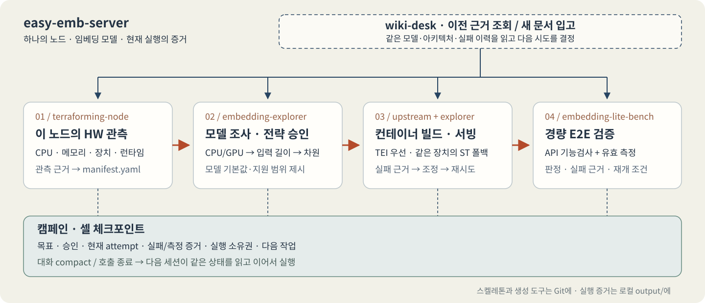
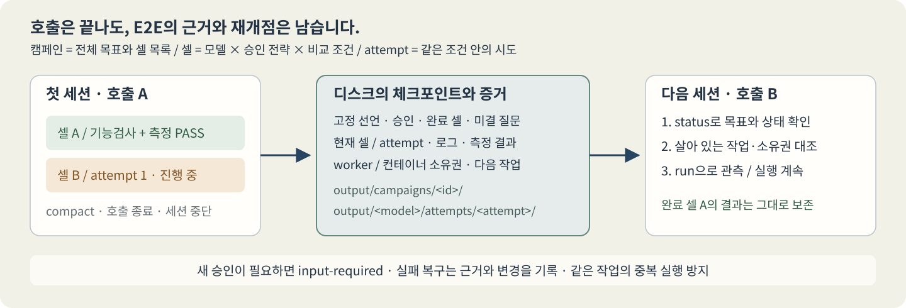

# easy-emb-server

> **로컬 임베딩 모델의 컨테이너 빌드·서빙·검증을 Codex와 함께 수행합니다.**

단일 노드의 하드웨어와 모델을 확인하고, 그 환경에 맞는 서빙 자산을 생성하는 작업 공간입니다. 사람이 **CPU/GPU → 최대 입력 토큰 → 출력 차원**을 결정하면, Codex가 빌드·기동·실패 분석·재시도·경량 E2E 검증을 이어갑니다.

[easy-vllm-simulator](https://github.com/tbvjvsladla/easy_vllm_simulator)의 스켈레톤·생성엔진 접근을 임베딩 서빙에 맞춰 간소화했습니다. 기본 API는 `/v1/embeddings`이며, 여러 모델이나 설정을 오래 검증할 때는 캠페인·셀 체크포인트로 다음 세션에 작업을 넘깁니다.



## 시작하기

필요한 환경은 **Node.js 24.12 이상**, **Docker와 Buildx**, **uv**(고정 의존성 해석용), 로컬 모델 폴더입니다. GPU를 선택하면 해당 장치의 드라이버와 컨테이너 실행 환경도 필요합니다. 모델 다운로드와 접근 권한은 사용자가 준비합니다.

```bash
git clone https://github.com/tbvjvsladla/easy_emb_server.git
cd easy_emb_server
npm ci --ignore-scripts --no-audit --no-fund
codex
```

Codex에 모델 위치와 원하는 작업을 알려주세요.

> `/mnt/models`의 임베딩 모델을 조사해줘. 먼저 이 노드의 HW를 확인하고, 모델별 장치·입력 길이·출력 차원을 제안한 뒤 승인한 설정으로 빌드·서빙·경량 검증까지 진행해줘.

에이전트는 [AGENTS.md](AGENTS.md), [작업 규칙](rules/workflow.md), 작업별 스킬을 따라 진행합니다. 프로젝트 실행 권한 설정은 신뢰한 새 Codex 세션에서 적용되며, 자세한 범위는 [승인 관리](rules/codex-permissions.md)에 있습니다.

네 역할은 각 스킬 팩의 `SKILL.md`와 `src/` 구현으로 구성됩니다. 역할별 CLI가 TypeScript 게이트를 실행하며 JSON과 YAML을 읽습니다. 구현 소유권과 공통 기반은 [게이트 계약](rules/harness.md#구현-소유권)에 정리했습니다. [결정론적 게이트](rules/harness.md)가 승인·입력·실행 소유권·측정 증거를 검사합니다. TEI Rust와 sentence-transformers/PyTorch·API Python은 생성 컨테이너 안에서 각 기본 언어를 유지합니다.

스킬별로 에이전트의 판단과 결정론적 코드가 맡는 책임, 서로 협력하는 방식은 [스킬 팩 README](.agents/skills/README.md)에 정리했습니다. 스킬의 역할을 이해하거나 확장할 때 참고하세요.

## 한 모델의 서빙 흐름

먼저 하드웨어를 관측하고 모델 메타데이터를 조사합니다. `inventory`와 `inspect`는 가중치를 로드하지 않습니다.

```bash
node .agents/skills/terraforming-node/src/cli.ts init
node .agents/skills/embedding-explorer/src/cli.ts inventory --model-root /mnt/models
node .agents/skills/embedding-explorer/src/cli.ts inspect --model /mnt/models/my-embedding-model
```

`manifest.yaml`에는 CPU·메모리·가속기·OS·컨테이너 런타임의 관측값과 출처가 남습니다. 모델 조사는 기본 입력 길이, 원래 출력 차원, 지원되는 차원 축소, 프롬프트·풀링·정규화와 전용 어댑터 필요 여부를 확인합니다.

사람이 장치·입력 길이·차원을 확정하면 승인 영수증을 기록합니다. 아래 `512`는 예시이며 실제 모델의 지원값과 사용자 결정으로 바꿉니다. `approval-reference`에는 [실제 사용자 메시지 출처를 연결한 JSON](.agents/skills/embedding-explorer/references/approval.md)의 경로를 적습니다. 기존 실제 승인은 범위·무결성을 확인해 재사용합니다.

```bash
node .agents/skills/embedding-explorer/src/cli.ts approve \
  --model /mnt/models/my-embedding-model \
  --device cpu --context-window 512 --dimensions native \
  --approval-reference /path/to/user-approval.json
```

이후 명령의 `<strategy>`에는 반환된 영수증 경로를, `<attempt>`에는 빌드가 반환한 시도 경로를 넣습니다.

```bash
node .agents/skills/embedding-upstream/src/cli.ts prepare --manifest manifest.yaml
node .agents/skills/embedding-upstream/src/cli.ts build --strategy <strategy> --release-lock output/host/upstream-lock.json
node .agents/skills/embedding-explorer/src/cli.ts serve --attempt <attempt> --port 18080
node .agents/skills/embedding-lite-bench/src/cli.ts bench --attempt <attempt> --routine config/lite.yaml
node .agents/skills/embedding-explorer/src/cli.ts stop --attempt <attempt>
```

선택한 장치와 설정에서 **TEI를 우선 사용**합니다. 호환되지 않거나 실제 로드가 실패하면 근거를 남기고 같은 장치의 **sentence-transformers**로 전환합니다. 엔진·dtype·빌드 조건은 에이전트가 판단하며, 장치·입력 길이·출력 차원을 바꿀 때는 다시 사용자 결정을 받습니다. 전용 처리나 풀링이 필요한 모델은 해당 의미를 확인해 어댑터를 마련해야 합니다.

서버는 명시적으로 `stop`할 때까지 유지됩니다. 포트 기본값은 `8080`, 위 예시는 `18080`을 사용하며 기본 바인딩은 `127.0.0.1`입니다. 동시에 띄울 모델 수와 자원 배치는 현재 노드의 관측값을 보고 정합니다.

## 임베딩 API

```bash
curl http://127.0.0.1:18080/health
curl http://127.0.0.1:18080/info
curl http://127.0.0.1:18080/v1/embeddings \
  -H 'Content-Type: application/json' \
  -d '{"input":["검색할 문장","비교할 문장"],"input_type":"query"}'
```

문자열 또는 문자열 배치를 받아 float 벡터를 반환합니다. `input_type`으로 모델의 query/document 프롬프트를 선택할 수 있고, 차원 축소는 모델이 지원하고 사용자가 승인한 범위에서 적용합니다. 입력 상한을 넘으면 거부하며, 기본값·실효 설정은 `/info`에서 확인합니다.

PPLX context 모델에서 기본 API의 각 문자열은 독립 문서의 한 청크입니다. 한 문서의 여러 청크를 함께 처리하려면 `/v1/contextualizedembeddings`에 문서별 청크 배열을 보냅니다.

```bash
curl http://127.0.0.1:18080/v1/contextualizedembeddings \
  -H 'Content-Type: application/json' \
  -d '{"input":[["첫 번째 청크","이어지는 청크"],["별도 문서"]]}'
```

응답의 `document_index`와 `chunk_index`가 원문 위치를 가리킵니다. 입력 상한은 구분 토큰을 포함한 문서 전체에 적용하며, 예약 구분 문자열 `<|endoftext|>`는 청크 본문에서 거부합니다. 모델의 기본 양자화와 정규화 정책은 `/info`와 모델 설정에서 확인합니다.

TEI는 백엔드 컨테이너와 정책 게이트웨이로, sentence-transformers는 독립 HTTP 컨테이너로 실행됩니다. 두 경로 모두 같은 승인 전략과 API 정책을 따릅니다.

## 여러 모델·설정을 오래 검증하기

**캠페인**은 전체 목표와 대상 목록이고, **셀**은 모델 × 승인 전략 × 비교 조건입니다. 같은 조건의 실패 복구는 해당 셀 안에 새 **attempt**로 쌓습니다. 빌드 방식이나 서빙 설정을 비교하려면 별도 셀로 선언합니다.



[캠페인 템플릿](campaigns/_template/campaign.yaml)을 복사해 모델 경로와 비교 조건을 채우고 시작합니다. 기존 승인 영수증을 연결할 수 있고, 승인이 없으면 `input-required`와 질문 ID를 반환합니다.

```bash
node .agents/skills/embedding-explorer/src/cli.ts campaign init --spec /path/to/campaign.yaml
node .agents/skills/embedding-explorer/src/cli.ts campaign status --campaign output/campaigns/<id>
node .agents/skills/embedding-explorer/src/cli.ts campaign run --campaign output/campaigns/<id> --timeout 600
```

대화가 compact되거나 새 `codex exec` 호출로 넘어가면 **같은 경로의 `status`부터 읽고 `run`을 이어갑니다.** 목표·승인·현재 셀·attempt·미결 질문·다음 작업이 디스크에 남습니다. 호출 시간이 끝나도 이미 시작한 유한 단계 worker가 살아 있을 수 있으므로, 실제 프로세스와 컨테이너의 소유권을 대조해 중복 실행을 막습니다. 모든 프로세스가 종료된 경우에는 남은 증거를 확인하고 복구합니다.

체크포인트를 읽을 수 있는 동일 작업 공간에서 대화형 세션과 외부 워커 호출이 이 규약을 함께 사용할 수 있습니다. 실패 복구·미해결 판정·보고·재개 명령은 [캠페인 규약](campaigns/README.md)을 참고하세요.

## 검증과 증거

모델별 **PASS는 현재 시도의 API 기능검사와 유효한 경량 측정이 함께 통과한 상태**입니다. 개수·순서·차원·유한 벡터·실제 장치·입력 경계를 확인하고, 선언된 요청 수에 맞춰 지연시간과 처리량을 기록합니다. 루틴은 [config/lite.yaml](config/lite.yaml)에 있습니다.

생성 Dockerfile, 설정 YAML·실행 SH·환경 ENV, 이미지 참조, 승인·환경 스냅샷, 실패 로그와 측정값은 `output/<model>/attempts/<attempt>/`에 보존합니다. 필요한 빌드·런타임 패치와 실제 적용 이력도 해당 시도에 연결합니다. 캠페인은 이 원문 증거를 가리키며, 미해결 셀에는 이유와 재개 조건을 남깁니다.

기존 하네스의 개발 환경 검증에서 NAS 18종 × CPU/GPU, 총 36개 셀을 처리했습니다(2026-10-23). 모델 기본 입력 길이·원래 출력 차원을 유지한 텍스트 임베딩 E2E에서 17종 34개 셀이 CPU와 RTX 5090에서 PASS했습니다. `nomic-xlm-2048`은 마스킹 언어 모델이며 문장 임베딩 파이프라인의 근거가 없어 CPU/GPU 2개 셀을 BLOCKED로 기록했습니다. 이 과거 결과는 TypeScript 하네스와 Luna none의 새 검증을 대신하지 않습니다. 전체 검증·미해결 보고 완료와 전 모델 PASS를 구분합니다.

별도 연속성 검증에서는 실제 Codex 호출을 종료하고 새 호출로 이어가는 동작도 확인했습니다. 다른 모델·장치·환경은 현재 실행의 증거로 다시 판정합니다.

모델별 설정·측정값·복구 과정과 미해결 조건은 [E2E 종합 보고서](docs/report/e2e-campaign-results.md)에 정리했습니다.

## 저장소에 포함되는 것

| 공개하는 자산 | 로컬에 보존하는 자산 |
|---|---|
| 운영 소스·공통 설정·작업 규칙 | 모델 가중치·`manifest.yaml`·인증정보 |
| `.agents/skills/`·공통 Codex 권한 설정 | 개인 권한 규칙·에이전트 세션·인터뷰·Seed |
| 캠페인 템플릿·문서 골격·README 이미지 | 실제 캠페인·시도별 생성물·측정·로그 |
| 재생성 도구·검증 도구·공개 report | 발행 plan/devlog/checklist·로컬 위키 색인·`temp/`·`tests/` |

배포 경계는 [.gitignore](.gitignore)에 정리되어 있습니다. 클론한 뒤 자신의 모델과 환경으로 서빙 자산을 생성합니다. 장치 지원 경로와 엔진 버전은 [config/platforms.yaml](config/platforms.yaml)·[config/versions.yaml](config/versions.yaml)에 있으며, 실제 실증 여부와 구분합니다.

## 개발·문서

`temp/`와 `tests/`는 중첩 위치를 포함해 로컬 임시 코드로 보존하며 배포하지 않습니다. 로컬 테스트 소스가 있는 개발 환경에서는 `node .agents/validation/verify.ts`로 TypeScript 검사·lint·하네스와 wiki-desk 회귀를 실행하고 로그를 `output/validation/`에 남깁니다. 테스트 소스가 없는 항목은 `UNAVAILABLE`로 기록하며 검증 성공으로 집계하지 않습니다. 실제 host lease를 사용하는 하네스 회귀는 빌드·서빙·upstream 준비와 동시에 실행하지 않습니다.

실제 모델 검증은 앞의 `bench`와 캠페인 흐름을 사용합니다. 합성 테스트는 실제 모델의 서빙 E2E를 대신하지 않습니다. 문서 작성·검색·입고는 [문서 규칙](rules/docs.md)과 [wiki-desk](.agents/skills/wiki-desk/SKILL.md)를 따릅니다.
