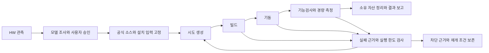

# TypeScript 하네스와 Luna none E2E 결과

> **SUPERSEDED-IN-PART — 2026-10-24:** 이 문서는 중앙 TypeScript 구현의 r4 실측을 보존한다. 실제 코드를 네 스킬 폴더로 이관하고 `tools/`를 제거한 후속 작업과 선정 3종 재검증은 [역할별 스킬 팩 보고서](skill-pack-luna-e2e.md)를 따른다. 아래 과거 코드 링크는 당시 검증 커밋에 고정했다.

**네 작업 스킬의 호스트 제어를 TypeScript로 이식하고, 고정된 최종본을 실제 Codex `gpt-6-luna`·reasoning `none`으로 검증했다. 전체 18종 × CPU/GPU 36조건은 34 PASS, 기존 `nomic-xlm-2048` 두 조건은 현재 근거를 갖춘 BLOCKED다.** 대표 6조건과 실제 호출 중단·재개 3조건도 각각 새 시도로 통과했다. 최종 driver는 모델 수용 기준·실제 실행 모델·독립성·소스 불변성 검사를 모두 통과했다.

평가 ID는 `harness-luna-261023-r4`, 소스 커밋은 `d4e818980f117c42cff4a38886c7710ee2458e72`다. 고정은 2026-10-24 07:01:11 KST, 전체 36조건 실행은 07:10:26~09:01:15 KST에 수행했다. 이전 평가의 부분 성공을 이번 성공으로 합산하지 않았다. [전체 driver 결과](../../output/evaluations/harness-luna-261023-r4/groups/full36/1792793426330-fc2c5099/result.json)

## 하네스의 변경과 언어 경계

호스트 CLI·HW 관측·승인·빌드 제어·서빙 제어·캠페인·검증 판정은 native TypeScript다. 컨테이너 내부 TEI의 Rust와 ST/PyTorch 및 API 어댑터의 Python은 유지했다. 기준 소스 `c6599c93`부터 최종 소스까지 `runtime/`의 동작 코드를 바꾸지 않았다. TypeScript 작성에는 전역 `typescript-guidelines`를 적용했다.

| 스킬 | 코드가 담당하는 결정과 게이트 |
|---|---|
| [terraforming-node](../../.agents/skills/terraforming-node/SKILL.md) | [hardware.ts](https://github.com/tbvjvsladla/easy_emb_server/blob/d4e818980f117c42cff4a38886c7710ee2458e72/tools/embedding/hardware.ts): HW를 관측해 manifest를 만들고, 미관측·조회 실패·실질 환경 변경과 실행 적용성을 판별한다. |
| [embedding-upstream](../../.agents/skills/embedding-upstream/SKILL.md) | [upstream.ts](https://github.com/tbvjvsladla/easy_emb_server/blob/d4e818980f117c42cff4a38886c7710ee2458e72/tools/embedding/upstream.ts), [attempts.ts](https://github.com/tbvjvsladla/easy_emb_server/blob/d4e818980f117c42cff4a38886c7710ee2458e72/tools/embedding/attempts.ts): 공식 안정 릴리스·이미지·의존성을 고정하고 승인된 입력으로 Dockerfile과 시도를 생성·빌드한다. |
| [embedding-explorer](../../.agents/skills/embedding-explorer/SKILL.md) | [models.ts](https://github.com/tbvjvsladla/easy_emb_server/blob/d4e818980f117c42cff4a38886c7710ee2458e72/tools/embedding/models.ts), `attempts.ts`: 모델과 실제 사용자 승인 출처를 검증하고 장치·토큰·차원을 보존하며 기동·복구·소유 자산 정리를 수행한다. |
| [embedding-lite-bench](../../.agents/skills/embedding-lite-bench/SKILL.md) | [bench.ts](https://github.com/tbvjvsladla/easy_emb_server/blob/d4e818980f117c42cff4a38886c7710ee2458e72/tools/embedding/bench.ts): 현재 시도의 API 기능·요청 회계·장치·입력 경계·사후 health와 측정 원문을 대조해 결과를 판정한다. |

초기화의 HW 관측 이후, 런타임의 세 스킬은 공통 [캠페인](https://github.com/tbvjvsladla/easy_emb_server/blob/d4e818980f117c42cff4a38886c7710ee2458e72/tools/embedding/campaign.ts)과 [복구](https://github.com/tbvjvsladla/easy_emb_server/blob/d4e818980f117c42cff4a38886c7710ee2458e72/tools/embedding/recovery.ts) 코드를 사용한다. checkpoint가 승인·현재 시도·소유권·미결 사항·다음 작업을 보존한다.

CPU/GPU → 최대 입력 토큰 → 출력 차원은 실제 사용자 승인 조건이다. 엔진·dtype·실행 예산은 그 범위 안의 타입·한도·근거가 있는 조절값이다. 승인 검사, 실행 소유권, 현재 증거 판정, 소유 자산 정리를 끄는 조절값은 없다. 직접 CLI와 캠페인 효과 함수가 같은 필수 검사를 수행한다. [공통 계약](../../rules/harness.md)

실행 lease는 하위 명령에도 상속한다. boot·PID 시작 시각·PID namespace를 대조하고, 살아 있는 작업이나 다른 소유 자산을 덮어쓰지 않는다. 재시도는 실제 실패와 변경·새 관측에 연결하고 같은 셀의 유한 예산을 공유한다. 현재 runtime에서 가능한 동일 장치 ST 후보가 남으면 근거 없는 BLOCKED 처분을 거부한다. 과거 PASS·mock·빌드 성공은 현재 E2E PASS를 대신하지 않는다.

## 평가 조건과 검증 범위

| 항목 | 관측·고정 조건 |
|---|---|
| 호스트 | 단일 WSL Ubuntu 24.04, x86_64, CPU 논리 코어 32개 |
| RAM / GPU | 67,422,572,544 bytes RAM; NVIDIA RTX 5090 32,607 MiB, compute capability 12.0, driver 617.42 |
| 실행 도구 | Node.js 24.15.0, Docker 28.3.0, Codex CLI 0.163.0 |
| upstream | 조회 당시 공식 최신 안정 TEI 1.9.4, sentence-transformers 6.2.0 |
| ST 공통 의존성 | torch 2.14.1(+cpu / +cu130), torchvision 0.29.1, Transformers 5.20.2, tokenizers 0.23.3, triton 3.8.0(CUDA) |
| 입력 고정 | 프로젝트 소스·정책·스킬·설정 75파일, upstream 원문·commit·이미지 digest·설치 URL/hash |
| 실행 순서 | 모델을 읽기 전용으로 사용, 승인된 비교 조건별 순차 실행, TEI 우선 및 근거 있는 같은 장치 ST 복구 |
| 자원 한도 | backend CPU 24개, RAM 및 memory+swap 각각 40,453,543,526 bytes; 호스트 관측에서 산출 |
| 복구 한도 | 셀별 최대 8시도·4시간; 근거가 있는 변경과 기존 예산 상속 필요 |
| 경량 측정 | warmup 2회, 측정 12요청, 동시성 2, 짧은 한국어·영어 입력; full36의 측정루틴 timeout 600초 |
| 장문 기능검사 | 승인한 실제 tokenizer 상한 수락과 상한+1 거부; 32K 조건의 기능검사 한도 1800초 |

TEI commit은 `e80ef225ed0e6cb1717ce632a6a84b6cf211bb67`, ST commit은 `0b6937d55981e3486caf9b64ad2664c9a9edb51d`다. 릴리스 조회 시각·원문·commit은 고정 upstream에 보존했다. 이미지와 의존성은 각 시도의 입력에 연결했으며 Docker 빌드 캐시는 재사용했다. [TEI 릴리스](https://github.com/huggingface/text-embeddings-inference/releases/tag/v1.9.4), [ST 릴리스](https://github.com/huggingface/sentence-transformers/releases/tag/v6.2.0), [고정 upstream](../../output/evaluations/harness-luna-261023-r4/inputs/upstream-lock.json)

| 실제 평가 묶음 | 결과 | 정본 |
|---|---|---|
| 새 Codex의 프로젝트·4스킬 발견 | PASS | [discovery](../../output/evaluations/harness-luna-261023-r4/discovery.json) |
| E5 small/base·EmbeddingGemma 300M × CPU/GPU | 새 실측 6 PASS | [대표 6](../../output/evaluations/harness-luna-261023-r4/groups/representative6/latest.json) |
| small CPU → small GPU → base CPU 중단·재개 | 새 실측 3 PASS, 제어 PASS | [엄격 3](../../output/evaluations/harness-luna-261023-r4/groups/strict3/latest.json) |
| 전체 18종 × CPU/GPU | 새 실측 34 PASS / 현재 근거의 2 BLOCKED, 수용 기준 PASS | [전체 36](../../output/evaluations/harness-luna-261023-r4/groups/full36/latest.json) |

대표 6과 엄격 3은 메인 36조건과 별도 시도다. 전체 그룹의 고유 범위를 45조건으로 확대하지 않는다. 실제 모델 실행은 Luna가 수행했고, 최상위 모델은 고정 평가 중 원시 결과를 관찰했다. 수정·복구 힌트·대신 실행을 통한 해결 개입은 없었으며, driver가 실제 세션의 모델·effort·도구 호출을 확인했다.

## 전체 36조건의 실측 결과

최종 checkpoint/report sequence는 **598**이다. 실제 생성 시도는 **40개**, 승인 조건을 유지한 TEI→ST 재시도는 **6회**였다. 성공 조건은 TEI 18개·ST 16개이고, 본 측정은 **408/408요청 성공**이다. 아래 RPS와 p95는 각 성공 시도의 짧은 12요청 관측값이다.

| 모델 | 장치 | 입력 상한 | 차원 | 엔진 | dtype | 결과 | RPS | p95 ms |
|---|---|---:|---:|---|---|---|---:|---:|
| multilingual-e5-small | cpu | 512 | 384 | tei | float32 | PASS | 34.5051 | 68.87 |
| multilingual-e5-small | gpu | 512 | 384 | tei | float16 | PASS | 36.3818 | 60.95 |
| multilingual-e5-base | cpu | 512 | 768 | tei | float32 | PASS | 23.8281 | 104.15 |
| multilingual-e5-base | gpu | 512 | 768 | tei | float16 | PASS | 29.9706 | 64.16 |
| embeddinggemma-300m | cpu | 2048 | 768 | tei | float32 | PASS | 12.0732 | 164.37 |
| embeddinggemma-300m | gpu | 2048 | 768 | tei | float32 | PASS | 26.4859 | 67.82 |
| multilingual-e5-large | cpu | 512 | 1024 | tei | float32 | PASS | 16.2954 | 116.17 |
| multilingual-e5-large | gpu | 512 | 1024 | tei | float16 | PASS | 25.0105 | 100.93 |
| KoE5 | cpu | 512 | 1024 | tei | float32 | PASS | 7.1034 | 290.53 |
| KoE5 | gpu | 512 | 1024 | tei | float16 | PASS | 25.1317 | 79.02 |
| mdbr-leaf-ir | cpu | 512 | 768 | tei | float32 | PASS | 33.1785 | 61.23 |
| mdbr-leaf-ir | gpu | 512 | 768 | tei | float16 | PASS | 38.2881 | 52.68 |
| KURE-v1 | cpu | 8192 | 1024 | tei | float32 | PASS | 6.7499 | 321.88 |
| KURE-v1 | gpu | 8192 | 1024 | tei | float16 | PASS | 28.5797 | 80.48 |
| nomic-embed-text-v1 | cpu | 8192 | 768 | tei | float32 | PASS | 21.8338 | 85.39 |
| nomic-embed-text-v1 | gpu | 8192 | 768 | tei | float16 | PASS | 34.5156 | 73.62 |
| nomic-embed-text-v1.5 | cpu | 8192 | 768 | tei | float32 | PASS | 19.3682 | 113.93 |
| nomic-embed-text-v1.5 | gpu | 8192 | 768 | tei | float16 | PASS | 28.5526 | 67.24 |
| embeddinggemma-2 | cpu | 8192 | 768 | ST | float32 | PASS | 12.6688 | 156.12 |
| embeddinggemma-2 | gpu | 8192 | 768 | ST | bfloat16 | PASS | 17.7500 | 108.21 |
| Qwen3-Embedding-4B | cpu | 32768 | 2560 | ST | float32 | PASS | 0.7456 | 2806.99 |
| Qwen3-Embedding-4B | gpu | 32768 | 2560 | ST | bfloat16 | PASS | 23.6022 | 82.88 |
| pplx-embed-v1-0.6b | cpu | 32768 | 1024 | ST | float32 | PASS | 5.5757 | 367.79 |
| pplx-embed-v1-0.6b | gpu | 32768 | 1024 | ST | float16 | PASS | 23.0788 | 136.93 |
| pplx-embed-v1-4b | cpu | 32768 | 2560 | ST | float32 | PASS | 0.8536 | 2529.75 |
| pplx-embed-v1-4b | gpu | 32768 | 2560 | ST | float16 | PASS | 18.9267 | 137.07 |
| kanana-nano-2.1b-embedding | cpu | 512 | 1792 | ST | float32 | PASS | 1.7165 | 1178.92 |
| kanana-nano-2.1b-embedding | gpu | 512 | 1792 | ST | bfloat16 | PASS | 25.9557 | 77.74 |
| Qwen3-VL-Embedding-2B | cpu | 32768 | 2048 | ST | float32 | PASS | 1.9528 | 1015.70 |
| Qwen3-VL-Embedding-2B | gpu | 32768 | 2048 | ST | bfloat16 | PASS | 19.5399 | 136.10 |
| pplx-embed-context-v1-0.6b | cpu | 32768 | 1024 | ST | float32 | PASS | 3.3939 | 636.70 |
| pplx-embed-context-v1-0.6b | gpu | 32768 | 1024 | ST | bfloat16 | PASS | 12.9723 | 195.87 |
| pplx-embed-context-v1-4b | cpu | 32768 | 2560 | ST | float32 | PASS | 0.3895 | 5586.99 |
| pplx-embed-context-v1-4b | gpu | 32768 | 2560 | ST | bfloat16 | PASS | 9.9675 | 239.76 |
| nomic-xlm-2048 | cpu | 2048 | 768 | — | — | BLOCKED | — | — |
| nomic-xlm-2048 | gpu | 2048 | 768 | — | — | BLOCKED | — | — |

ST에는 보존한 모델별 native 어댑터가 포함된다. Qwen3-VL은 텍스트 임베딩만 검증했다. `nomic-xlm-2048`의 토큰·차원은 승인 선언값이며, 두 조건은 prepare에서 차단되어 모델 컨테이너·벡터 출력·측정이 없다. 위 표의 성공 수치에는 과거 평가나 차단 조건을 포함하지 않았다.

API 검사는 응답 모델·개수·배치 순서·차원·finite 값·실제 장치·잘못된 입력 거부·실제 토큰 경계를 포함한다. contextual 경로는 문서·청크 매핑과 입력 오류도 검사했다. warmup과 본 측정을 구분하고 요청 원문에서 회계를 재계산한 뒤 사후 health 및 컨테이너 정체성을 확인한다. 속도 문턱이나 정확도 점수를 PASS 조건으로 추가하지 않았다.

전체 독립 감사는 현재 34개 성공 시도의 기능 HTTP 기록 1,262개·warmup 68개·본 측정 408개를 대조하고, 실패·복구를 포함한 native 명령 240쌍을 확인했다. 두 차단 조건의 새 실패 worker와 handoff, 실제 Luna 세션 및 고정 소스도 확인했고 차단 결함은 없었다. API를 다시 호출한 실험이 아닌 보존 원문 감사다. [전체 감사](../../output/validation/review/261024-luna-r4-full36-evidence/peer-review.json)

## 실제 실패와 자동 복구

| 대상 | 현재 평가의 첫 실패 원문 | 같은 승인 조건의 후속 결과 |
|---|---|---|
| Qwen3-Embedding-4B CPU | TEI warmup 중 컨테이너 `OOMKilled=true`, exit 137 | ST/float32로 1회 재시도, 새 PASS |
| Qwen3-Embedding-4B GPU | TEI warmup의 `CUDA_ERROR_OUT_OF_MEMORY`, exit 1, `OOMKilled=false` | ST/bfloat16로 1회 재시도, 새 PASS |
| Kanana CPU/GPU | TEI가 pooling 설정 `1_Pooling/config.json`을 찾지 못해 종료 | 각 장치의 ST native 경로로 1회씩 재시도, 각각 새 PASS |
| Qwen3-VL CPU/GPU | TEI가 pooling 설정을 찾지 못해 종료 | 각 장치의 ST native 텍스트 경로로 1회씩 재시도, 각각 새 PASS |

각 복구는 실패 worker·봉인한 원문·소유 자산 정리·변경 가설·새 시도를 연결한다. CPU/GPU, 최대 입력 토큰, 출력 차원과 실제 승인 영수증은 바꾸지 않았다. 40개 생성 시도와 36개 조건을 혼동하지 않는다.

Luna의 일부 복구 가설 문장에는 다른 모델 계열인 “Gemma3” 명칭이 섞였다. 이 자유 서술은 정확하지 않았으나, 실제 승인·모델 fingerprint·mount·runtime·컨테이너 결합은 올바른 대상을 가리켰다. 원인 표는 설명 문장이 아닌 native 실패 원문을 사용했다. 결정론적 실행 게이트가 모델의 모든 서술 오류까지 없앤다는 주장은 하지 않는다. [복구와 현재 실측 감사](../../output/validation/review/261024-luna-r4-full36-evidence/peer-review.json)

### nomic-xlm 두 조건의 차단과 재개

두 조건은 이번 평가의 새 prepare worker에서 `model_adapter_required`로 차단됐다. 대상은 masked-LM/pre-training checkpoint이며, 현재 보존된 입력으로는 확립된 문장 임베딩 파이프라인과 pooling 의미를 확인하지 못했다. 동일 장치 ST 후보도 현재 native adapter에서 지원되지 않는 것으로 판정됐다. 근거 없는 pooling이나 출력 의미를 생성하지 않았다.

CPU/GPU 각각 현재 실패 worker 원문, 승인·모델·upstream 결합, 생성 시점의 복구 검토와 `asOf`를 포함한 불변 handoff를 남겼다. driver가 두 handoff를 모두 `valid=true, fresh=true`로 재검증했다. 과거 BLOCKED의 단순 복사는 아니다. 이 조건의 모델 서빙은 여전히 미해결이며, 이번 작업은 차단 원인과 재개 근거까지 보고한 상태다.

재개하려면 이 checkpoint에 맞는 검토된 pooling·embedding adapter 근거가 필요하다. 같은 승인 조건은 장치·2048토큰·768차원이며, 전략 축이나 모델 정체성이 달라지면 실제 HITL을 다시 받아야 한다. 소스·런타임·upstream을 고치면 이미 끝난 r4 결과를 덮어쓰지 않고 새 고정 평가에서 검증한다. [CPU handoff](../../output/campaigns/harness-luna-261023-r4-full36/unresolved/nomic-xlm-2048-cpu-7d5fd95d-1626-40a5-a3ac-b287182b8a1f.json), [GPU handoff](../../output/campaigns/harness-luna-261023-r4-full36/unresolved/nomic-xlm-2048-gpu-ccd92012-da0f-47ec-a4a8-19dc93ef30d6.json)

## 실제 호출 종료와 새 Luna 세션의 재개

엄격 3조건은 첫 Luna가 small CPU를 완료한 뒤 small GPU의 serve를 시작한 상태에서 시험했다. 2026-10-24 07:08:25 KST 첫 실제 Codex 호출자와 coordinator를 SIGKILL하고 종료를 확인했다. 원래 finite worker는 살아 있었으며, 다른 실제 Luna thread가 checkpoint를 읽어 같은 작업의 완료를 이어받았다.

원래 serve operation `18c7006d-c7e2-4a07-834c-49490af70454`는 정확히 한 번 완료됐다. 이미 끝난 첫 CPU 셀의 digest는 바뀌지 않았고, GPU bench 및 다음 base CPU 실행이 이어져 별도 3조건 모두 새 PASS했다. 두 thread는 `01a16ace-39b1-7cf0-9308-2be8dbdb8920`, `01a16ace-e295-7022-9285-0c918f1e97d2`다. [실제 중단·재개 driver](../../output/evaluations/harness-luna-261023-r4/groups/strict3/1792793262265-8c379dbf/result.json)

대표 6·엄격 3의 독립 원문 감사는 새 시도 9개, 기능 응답 301개, warmup 18개, 본 측정 108/108요청, 성공 위상 worker 45개와 native 명령 72쌍을 대조했다. 이는 실제 API를 재호출한 결과가 아니라 보존된 실제 실행 증거에 대한 감사다. [대표·엄격 감사](../../output/validation/review/261024-luna-r4-evidence/peer-review.json)

## 개발 검증과 이전 실패의 처분

| 근거 | 결과와 적용 범위 |
|---|---|
| [최종 통합검사](../../output/validation/verify/2026-10-23T215828-808Z/result.json) | typecheck·lint PASS, 하네스 123/123, wiki 240/240. lint 경고는 남아 있다. |
| [기동 경계 회귀](../../output/validation/serve-boundaries-261024/result.json) | 포트 충돌·부분 생성·readiness 실패의 child 3개 PASS. 실제 로컬 HTTP와 가짜 Docker를 사용한 회귀이며 실제 모델 실측에 합산하지 않는다. |
| [CPU 설치](../../output/validation/dependency-install/r3c-cpu/result.json) / [CUDA 설치](../../output/validation/dependency-install/r3c-gpu/result.json) | 43/62개 패키지의 실제 설치·import·잘못된 hash 거부 PASS. 모델과 가속기 추론을 수행하지 않은 설치 검증이다. |
| [P2 A 처분](../../output/validation/review/261024-recovery-closure/p2-a-peer.json) | worker 사망 후 봉인한 실패를 반복 재조정할 때 원래 snapshot을 유지하도록 보완, 실제 프로세스 종료 회귀와 독립 검토 완료. |
| [P2 B 처분](../../output/validation/review/261024-recovery-closure/p2-b-peer.json) | cleanup 실패가 이전 native 실패를 가리는 문제를 검증된 전체 실패 이력과 시점 결합으로 보완, 회귀·독립 검토 완료. |
| [설치 입력 검토](../../output/validation/review/261023-r3c-upstream/peer-review.json) | 공식 exact wheel 선택과 uv 원문·hash 보존 검토, findings 0. |
| [명령 생성 검토](../../output/validation/review/261024-command-rendering/peer-review.json) | 실제 shell 인자 보존·치환 거부·기존 고정 진입점 적용 검토, findings 0. |

r1은 discovery 응답 경로 형식에서 실패했다. r2는 대표 6·엄격 3을 통과했지만 전체 36이 18 PASS/18 BLOCKED여서 전체 수용 기준에 실패했다. ST 설치 입력과 실패·복구 판단을 보완한 뒤 이전 성공을 이월하지 않았다.

r3는 Luna가 고정 명령의 모든 token을 인용하면서 이 설치 환경의 임시 PID namespace에서 실행되어, worker 지속성 게이트가 모델 시도 전에 차단했다. 같은 세션에서 모델 없는 A/B 관측으로 재현했고, driver가 안전한 고정 단어는 그대로 두고 필요한 값만 인용하는 명령을 생성하도록 바꿨다. 권한이나 namespace 게이트를 완화하지 않았다. 이 관측은 해당 CLI·규칙 환경에 한정된다. [A/B 근거](../../output/validation/pid-namespace-quotes-261024/result.json)

수정 전 실패 기록과 평가 무효화를 보존한 뒤 소스 `d4e8189`에서 r4의 discovery·대표 6·엄격 3·전체 36을 모두 새로 실행했다. 개발 커밋은 `bd7bc7f`, `7cdaa75`, `36eb673`, `d4e8189`다. 개발 회귀·설치 probe·과거 실측과 최종 Luna 모델 E2E를 구분한다.

## 적용 한계와 보존 자료

이 결과는 관측한 단일 호스트와 설치된 CLI, 고정한 upstream 및 18종의 로컬 모델에 대한 실증이다. 모든 에이전트 모델·HW·모델 아키텍처에서 같은 성능을 보장하지 않는다. 공통 상태와 판정을 코드로 옮긴 뒤 실제 Luna none에서도 이 범위의 E2E를 수행할 수 있음을 확인했다.

짧은 12요청의 RPS/p95는 모델 품질 순위나 32K 입력 처리량이 아니다. 장문 기능검사는 별도이며 일부 CPU 조건은 약 16분이 걸렸다. 검색 정확도·기준 벡터 비교·장기 soak·전체 adversarial·멀티노드 검사는 수행하지 않았다. 메모리 기록은 전후 표본이며 peak 사용량 주장이 아니다. native quantizer의 작은 부동소수점 반올림은 원시 값 그대로 보존했다.

검증 종료 후 프로젝트 attempt label을 가진 실행 중 컨테이너는 0개였다. 생성 Dockerfile·설정·이미지 참조·실패·현재 측정·원시 세션과 재개 근거는 보존했다. [종료 후 관측](../../output/validation/report-prep-261024/post-evaluation-state.json)

원시 근거인 `output/`, 로컬 계획·devlog·checklist·분석 패키지는 일반 clone에 포함되지 않는다. 본문 표와 결론은 원시 파일 없이도 읽을 수 있도록 정리했으며 아래 경로는 해당 로컬 증거를 감사할 때 사용한다. 보고서 자체가 새로운 실행 승인이나 별도 PASS 판정은 아니다.

- [전체 캠페인 보고서](../../output/campaigns/harness-luna-261023-r4-full36/reports/598.json)
- [전체 독립 감사](../../output/validation/review/261024-luna-r4-full36-evidence/peer-review.json) · [모델별 원문 연결](../../output/validation/review/261024-luna-r4-full36-evidence/model-measurements.json)
- [7개 계획의 완료 기준](../../output/validation/plan-closure-261024/final-closure.json)
- [앞선 Python 캠페인의 역사 결과](e2e-campaign-results.md)
