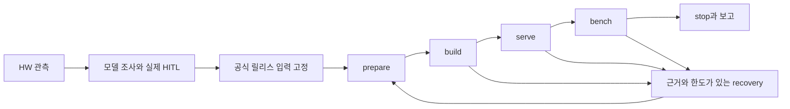

# 결정론적 실행 계약

호스트 제어는 네 스킬 팩 안의 TypeScript 구현과 전용 CLI가 수행한다. 에이전트는 목표·근거·복구 가설을 제안하고, 코드는 승인·상태·소유권·입력·검증 증거를 판별한다. 생성 컨테이너의 TEI Rust와 sentence-transformers/PyTorch 및 API 서버 Python은 각 런타임의 기본 언어를 유지한다.

## 구현 소유권

| 스킬 팩 | 실제 구현과 진입점 |
|---|---|
| terraforming-node | `src/hardware.ts`; `src/cli.ts init` |
| embedding-upstream | `src/upstream.ts`, `recipes.ts`, `build.ts`; `src/cli.ts prepare/check/build` |
| embedding-explorer | `src/models.ts`, `model-fingerprint.ts`, `attempts.ts`, `serving.ts`, `resources.ts`, `recovery.ts`, `campaign.ts`; `src/cli.ts inventory/inspect/approve/render/serve/capture/stop/campaign` |
| embedding-lite-bench | `src/bench.ts`; `src/cli.ts bench/report` |

공통 `.agents/harness/`는 직렬화·해시·파일 입출력·오류·프로세스/lease·CLI 인자 처리만 제공하며 스킬 구현을 import하지 않는다. `.agents/validation/`는 개발 검사·고정 모델 리뷰·실제 Luna 평가 도구다. 캠페인의 목표·승인·복구 상태는 explorer가 소유하고 각 위상의 실제 효과는 담당 스킬의 API에 위임한다. 스킬 팩은 이 저장소의 runtime/config와 공통 기반을 사용하는 협력 모듈이며 개별 폴더만 복사하는 독립 배포 단위는 아니다.

기존 `tools/` 진입점은 제거했다. 과거 output의 스크립트·명령·해시는 당시 증거로 보존한다. 새 실행은 해당 스킬의 CLI와 새 attempt를 사용한다. 과거 attempt의 cleanup도 explorer의 `capture/stop --attempt`에서 원래 자산 ID·소유권을 확인하며, 과거 `run.sh`를 재실행하지 않는다.

## 상태와 안전불변식

| 불변식 | 코드 정본 | 차단·재개 방식 |
|---|---|---|
| 실제 사람의 장치 → 토큰 → 차원 선택 | `.agents/skills/embedding-explorer/src/models.ts` | 승인 원문 줄·해시·선택값, 모델 fingerprint, manifest snapshot 대조. 모델/범위 변경은 HITL, 무결성 오류는 복구 |
| 환경 적용성 | `.agents/skills/terraforming-node/src/hardware.ts` | 현재 호스트와 승인 당시의 구조·실행 환경·선택 장치 대조. 미관측/실패를 지원으로 추정하지 않음 |
| 입력 고정 | `.agents/skills/embedding-upstream/src/upstream.ts`, `embedding-upstream/src/recipes.ts`, `embedding-explorer/src/attempts.ts` | 공식 최신 안정 릴리스 commit, 이미지 digest, 실제 설치 URL·공식 인덱스·의존성 hash lock, recipe/runtime/정책/스킬을 attempt에 연결 |
| 단일 실행 소유자 | `.agents/harness/processes.ts`, `campaign.ts` | host → campaign → attempt 실행 lease, boot/start/PID, checkpoint active phase 대조. 하위 실제 명령이 lease를 상속 |
| 실패 후 유한 복구 | `.agents/skills/embedding-explorer/src/attempts.ts`, `recovery.ts`, `campaign.ts` | 실제 실패와 승인 범위·렌더 입력·남은 한도로 복구 후보 판별. 남은 같은 장치 ST 경로를 근거 없이 차단 처리하지 않음 |
| 현재 증거의 PASS | `.agents/skills/embedding-lite-bench/src/bench.ts` | 같은 attempt의 기능검사·요청 회계·실측·사후 health와 컨테이너 정체성 검증. mock/과거 PASS는 새 PASS로 채택하지 않음 |
| 평가 조건 보존 | `.agents/validation/campaign_e2e.ts` | 소스·정책·upstream과 그룹별 조건 고정, 실제 Codex 세션의 model/effort 및 도구 호출 증거 대조 |

서빙 HITL은 실행 권한 승인과 별개다. `approve`에 임의의 문자열을 넣거나 도구 출력·에이전트 문장을 사람의 답으로 바꾸지 않는다. 새 승인은 실제 Codex session 저장소의 session ID·파일명·사용자 원문 줄을 검사한다. 기존 실제 영수증은 `config/legacy-approvals.json`에 고정한 원래 43개의 ID·digest·승인 원문 해시와 범위를 대조한다. 새로 만든 schema-1 파일을 과거 승인으로 받아들이지 않는다. 파일 해시는 보존 무결성을 확인하며 동일 사용자에 의한 의도적 파일 위조까지 인증하는 보안 장치는 아니다.

새 upstream 준비는 resolver 원문과 공식 PyTorch wheel index를 함께 보존한다. PyTorch 인덱스에서 해석한 패키지는 원래 버전·해시와 대상 Python/플랫폼에 맞는 유일한 공식 wheel URL로 고정하고, 나머지는 PyPI에서 설치한다. 설치 파일은 보존한 원문과 index 근거에서 재구성해 대조한다. 후보가 없거나 모호하면 새 어댑터 검토가 필요하며 임의 wheel이나 해시 없는 설치로 이어가지 않는다.

## 조절할 수 있는 값

장치·입력 상한·차원은 승인 영수증에 고정한다. 엔진·dtype·유한 phase timeout·builder·선언된 recipe는 코드가 허용하는 복구 조건 안에서 조절한다. 출력 차원을 바꾸거나 실패를 건너뛰는 `force/pass/skip-check` knob는 없다.

새 recipe/runtime/소스는 새 attempt에 반영한다. 기존 attempt의 생성 파일이나 `settings.yaml`을 손으로 수정해 판정을 바꾸지 않는다. 선언 recipe도 고정 base/의존성 설치/entrypoint를 유지하며 허용한 ENV와 주석용 LABEL만 추가한다. 새 패키지·실행 명령은 개발에서 입력 계약을 검토하고 다시 고정해야 한다. 캠페인의 비교 조건은 선언 때 고정하며 달라지면 새 셀이다. `campaign retry --phase ...`는 동일 설정에서 새로운 관측 근거로 위상을 재수행할 때 사용한다. 설정 변경은 새 attempt로 생성한다. 구체적 허용값·한도의 정본은 코드와 attempt의 `recovery_policy`다.

stop/capture는 복구 중 소스나 모델 파일이 바뀌었어도 원래 승인·설정·자산 ID·이미지·labels·실행 lease를 대조해 소유 자산을 정리할 수 있다. 이 제한된 정리 경로는 build/serve/bench의 현재 입력 검사를 우회하지 않는다.

긴 실행은 [캠페인 규약](../campaigns/README.md)에 따라 status → step/run으로 재개한다. checkpoint와 실제 프로세스·컨테이너가 불일치하면 기록된 원인을 조사한다. 살아 있는 작업을 덮어쓰거나 상태 파일을 직접 고치지 않는다. 오류 JSON의 `code`, `evidence`, `next_action`, `retryable`과 worker 로그를 사용한다.

실패한 셀의 status는 실제 renderer와 같은 어댑터·dtype·설치 입력을 사용해 `recovery_options`를 제시한다. `campaign resolve`는 승인된 장치에서 사용 가능한 ST 복구 후보가 남으면 `RECOVERY_REVIEW_REQUIRED`로 차단한다. 실제 재시도 실패, 동일한 고정 빌드 입력의 입증된 장애, 지원 부재 또는 복구 한도 소진을 근거로 판정하며 모델 이름이나 과거 PASS 목록으로 성공 경로를 정하지 않는다.

차단 보고는 현재 실패 worker와 원래 operation·셀·승인·모델·upstream을 묶은 불변 handoff를 남긴다. 과거 자료는 별도 배경 근거로 보존한다. 최종 평가에서 허용하는 BLOCKED도 현재 평가의 실제 실패와 그 시점의 복구 검토를 검증해야 한다. 과거 handoff를 읽을 수 있다는 사실은 새 평가의 차단 근거가 되지 않는다.

## 개발과 평가

각 스킬 팩은 `SKILL.md`의 판단 지침과 `src/`의 실제 결정론적 구현을 함께 소유한다. 모델이 설명을 생략하더라도 진입점의 필수 게이트는 수행된다. 동일 사용자 권한의 임의 Docker/파일 명령 자체를 격리하는 운영체제 보안 정책은 아니다. 해당 우회 실행은 하네스 증거로 인정하지 않는다.

소스 변경은 상위 모델로 구현·검토하고 `node .agents/validation/verify.ts`로 검증한다. 최종 Luna none 평가는 소스와 입력을 고정한 뒤 별도 evaluation에서 실행한다. 평가 중 소스 수정이나 상위 모델의 문제 해결 개입이 필요하면 그 평가의 실패 증거를 보존하고 개발로 돌아온다. 수정 후 새 evaluation 전체를 수행하며 이전 일부 PASS를 섞지 않는다.
